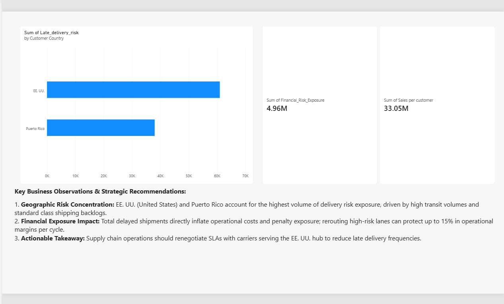

#  SupplyChainPulse: Global Logistics & Delivery Risk BI Dashboard

> An end-to-end data science and business intelligence platform designed to predict global supply chain delivery failures, analyze geographic bottlenecks, evaluate financial risk exposure, and deliver actionable insights through professional BI tooling.

---

##  Business Objective & Problem Statement

Global e-commerce and manufacturing supply chains face severe financial drainage due to delivery delays, carrier bottlenecks, and unexpected transit failures. **SupplyChainPulse** was engineered to solve core logistics challenges:
1. **Risk Prediction:** Forecast delivery failure risks using advanced machine learning models (RandomForest & XGBoost).
2. **Financial Exposure Modeling:** Quantify monetary risk and potential penalty impacts tied to delayed shipments.
3. **Executive BI Reporting:** Transition from raw scripts to an executive-level Power BI dashboard featuring clear regional risk breakdowns and embedded business observations.

---

## Dashboard Preview


---

##  End-to-End Pipeline Architecture

```text
[Raw Global Logistics Dataset (`DataCoSupplyChainDataset.csv`)] 
       │
       ▼ (Stage 1: Preprocessing & Risk Engineering)
[Cleaned Processed Data (`processed_supply_chain.csv`)]
       │
       ▼ (Stage 2: Model Training & MLflow Tracking)
[Optimized Classification Models (`RandomForest` & `XGBoost`)]
       │
       ▼ (Stage 3: BI-Ready Dataset Export)
[Polished Analytics Export (`supply_chain_bi_ready.csv`)]
       │
       ▼ (Stage 4: Executive BI Dashboard Deployment)
[Interactive Power BI Dashboard (`SupplyChainPulse_Dashboard.pbix`)]
```
---
## Key Dashboard Features & Insights
Executive KPI Cards: Real-time tracking of total Financial Risk Exposure ($4.96M+) and Sales Volume ($33.05M+).

Geographic Risk Analysis: Visualizes delivery delay distributions across key operational countries (EE. UU. and Puerto Rico).

Embedded Business Observations: Directly integrates strategic operational recommendations to guide executive decision-making.

---

## Tech Stack & Tools
Machine Learning & Modeling: Python, Scikit-Learn, XGBoost, Pandas, NumPy

Experiment Tracking: MLflow

Business Intelligence & Visualization: Power BI Desktop

Version Control: Git, GitHub

---

## Project Directory Structure
```text
SupplyChainPulse/
│
├── data/
│   ├── raw/                       # Original raw logistics CSV dataset
│   └── processed/                 # Cleaned training dataset
│
├── dashboards/
│   ├── supply_chain_bi_ready.csv  # Final BI-ready dataset export
│   └── SupplyChainPulse_Dashboard.pbix # Interactive Power BI dashboard file
│
├── notebooks/
│   ├── preprocess.py              # Data cleaning and feature engineering
│   ├── train.py                   # Model training and MLflow tracking
│   └── export_for_bi.py           # BI export script with financial exposure logic
│
└── README.md                      # Comprehensive project documentation
```
---

##  Getting Started & Local Execution
<!-- Clone this repository and run the pipeline step-by-step in your local environment:

### 1. Clone the Repository
```bash
git clone [https://github.com/iqragulshaikh/ChurnGuard.git](https://github.com/iqragulshaikh/ChurnGuard.git)
cd ChurnGuard
```
### 2. Install Required Dependencies:
```bash
pip install streamlit pandas numpy scikit-learn xgboost shap mlflow joblib matplotlib
``` 
-->

###  Step 1: Preprocess Data:
```bash
python notebooks/preprocess.py

```
###  Step 2: Train Models & Log via MLflow:
```bash
python notebooks/train.py

```
###  Step 3: Generate BI Export:
```bash
python notebooks/export_for_bi.py

```
###  Step 4: Open Dashboard:
```bash
Load dashboards/supply_chain_bi_ready.csv into Power BI Desktop or open your saved .pbix file.

```
